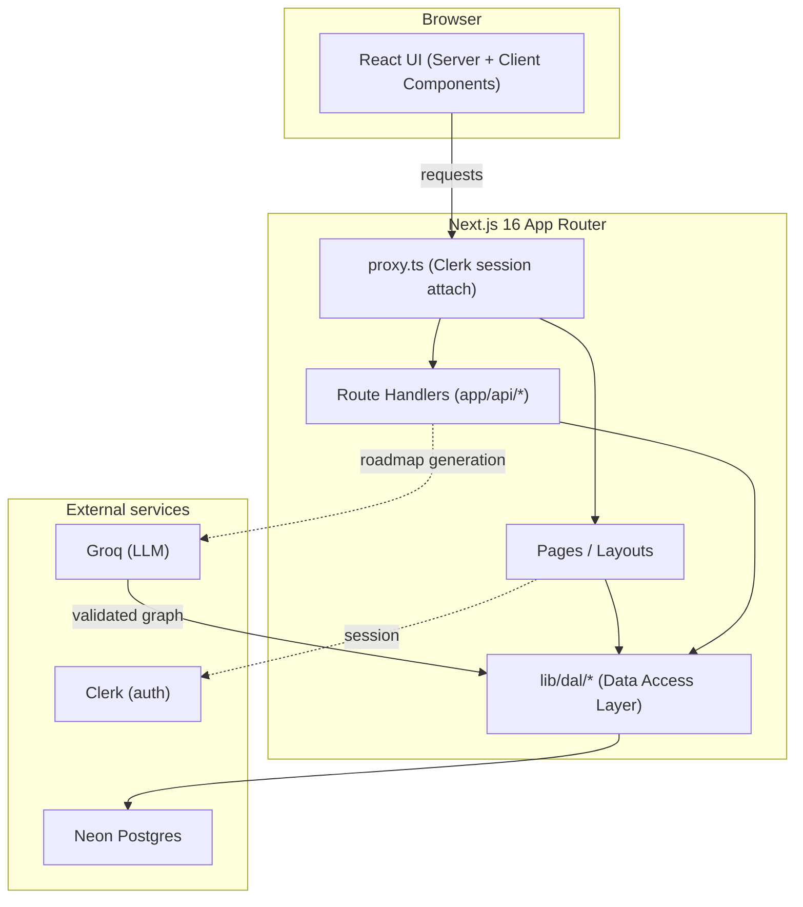
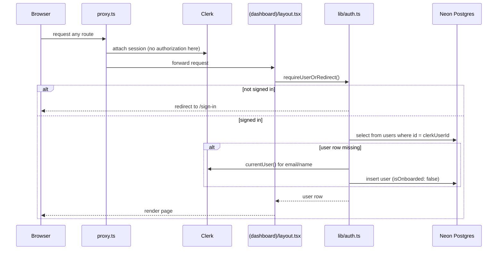
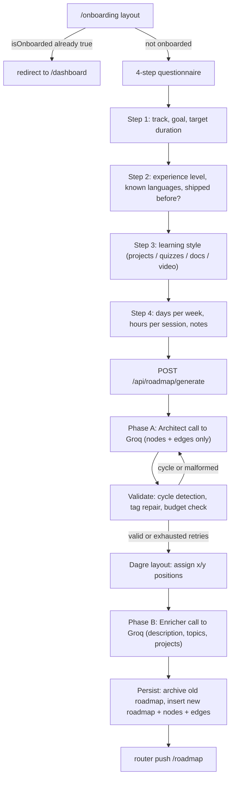
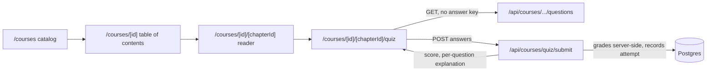

# PathwayAI

PathwayAI is a full-stack learning platform that turns a short questionnaire into a personalized, AI-generated computer science curriculum. A user signs in, answers questions about their target track, current skills, and available time, and Groq generates a prerequisite-graph roadmap (nodes and edges, not a flat list) that is rendered as an interactive node graph, backed by real progress tracking, a course engine with server-graded quizzes, and a metrics dashboard, all persisted in Postgres.

This is not the static prototype the project started as. Every number on screen is computed from real data: there are no mock arrays left in the pages that render the app.

## Table of contents

- [Tech stack](#tech-stack)
- [Architecture](#architecture)
- [Directory structure](#directory-structure)
- [Database schema](#database-schema)
- [Core flows](#core-flows)
  - [Authentication](#authentication)
  - [Onboarding and roadmap generation](#onboarding-and-roadmap-generation)
  - [Roadmap graph and node status](#roadmap-graph-and-node-status)
  - [Courses and quizzes](#courses-and-quizzes)
  - [Metrics engine](#metrics-engine)
  - [Resources](#resources)
- [Getting started](#getting-started)
- [Environment variables](#environment-variables)
- [Scripts](#scripts)
- [Known limitations](#known-limitations)

## Tech stack

| Layer | Choice | Notes |
|---|---|---|
| Framework | Next.js 16 (App Router, Turbopack) | Route groups for auth, onboarding, and the main app shell |
| Language | TypeScript | Strict mode |
| Auth | Clerk | Session attached via `proxy.ts` (Next 16's renamed `middleware.ts`) |
| Database | Neon Postgres | Serverless WebSocket driver (`@neondatabase/serverless`) |
| ORM | Drizzle | Schema-first, migrations via `drizzle-kit` |
| LLM | Groq (`openai/gpt-oss-120b`, fallback `openai/gpt-oss-20b`) | Two-phase structured generation, JSON mode |
| Graph layout | `@dagrejs/dagre` | Server-side layout, positions persisted |
| Visualization | `@xyflow/react` (React Flow) | Interactive roadmap canvas |
| Charts | Recharts | Dashboard and progress charts |
| Styling | Tailwind CSS v4 | Container queries for the responsive shell, `@tailwindcss/typography` for chapter content |
| UI primitives | Radix UI + custom `components/ui` | Shadcn-style, not a package dependency |
| Validation | Zod | LLM output schemas |
| Sanitization | DOMPurify (isomorphic) | Chapter HTML content |
| Toasts | Sonner | |

## Architecture



Key architectural decisions:

- **Data Access Layer (`lib/dal/*`).** Every database read or write goes through a DAL function, never straight from a page or route handler. Every DAL function calls `requireUser()` (or `getOptionalUser()` for public reads) itself, and any query for a resource owned by a specific user filters by that user's id in the query itself, not in an `if` check afterward. This matters because Next.js route handlers and Server Actions are directly reachable over HTTP; a layout-level auth check does not protect them.
- **`proxy.ts`, not `middleware.ts`.** Next.js 16 renamed the file. It only attaches the Clerk session to the request, it does not authorize anything by itself. Authorization always happens in the DAL.
- **Status is computed, never stored.** A roadmap node has no `status` column. `lib/roadmap/status.ts` derives `completed | in_progress | available | locked` from the prerequisite graph and the user's progress rows, every time it is read. This makes stale or contradictory status values structurally impossible instead of relying on remembering to update a column in the right place.
- **Lazy user provisioning.** There is no Clerk webhook for user creation. The first authenticated request for a given Clerk user id creates the corresponding row in the `users` table on the fly (`lib/auth.ts`). This avoids needing a public webhook endpoint and a tunnel during local development.
- **Two-phase LLM generation.** The roadmap is generated in an "Architect" call (graph structure: nodes, edges, hours, tags) followed by an "Enricher" call (descriptions, topics, projects for the now-validated nodes). Splitting it this way means a cheap structural retry (cycle detected, bad node count) does not require re-generating the expensive descriptive content.
- **Server-side quiz grading.** The client never receives `correctIndex` or `explanation` for a question until after it submits an answer. The public read path uses an explicit column allowlist rather than fetching everything and stripping fields, so it is not possible to accidentally leak the answer key by adding a field to a `select()`.

## Directory structure

```
app/
  (auth)/               Sign in / sign up pages, dark themed, outside the app shell
  onboarding/            The 4-step questionnaire, gated: redirects to /dashboard if already onboarded
  (dashboard)/           Route group for the authenticated app shell
    layout.tsx           Sidebar + header shell, requires auth
    dashboard/            Metrics dashboard
    roadmap/               Interactive node graph
    courses/[courseId]/[chapterId]/(quiz)   Course reader and quiz
    progress/              Progress charts
    resources/              Curated resource library
    settings/               Clerk account management
  api/
    roadmap/generate/       Kicks off the two-phase Groq pipeline
    roadmap/node/status/    Marks a node in_progress / completed
    courses/.../questions/  Serves quiz questions WITHOUT answers
    courses/quiz/submit/    Grades a quiz submission server-side
    resources/save/         Toggles a saved resource
    health/                 DB connectivity check

lib/
  auth.ts                requireUser / requireUserOrRedirect / getOptionalUser, all DB-backed
  db/
    client.ts             Neon Pool + Drizzle instance, HMR-safe singleton, pool error handler
    retry.ts              Retry-with-backoff wrapper for transient Neon connection drops
    schema/                Drizzle table definitions (see Database schema below)
  dal/                    Data Access Layer: roadmap.ts, courses.ts, resources.ts, metrics.ts
  groq/
    generator.ts           Orchestrates the two-phase generation + persistence
    schema.ts               Zod schemas for LLM output, allowed CS tag vocabulary
    validator.ts             Cycle detection, tag repair, Dagre layout, fallback graphs
  roadmap/status.ts        Pure function: computes node status from progress + prerequisites
  seed-data/               Typed course and resource content used by the seed script

components/
  shell/                  AppShell, PageHeader, SidebarNav, DesktopSidebar, MobileNavTrigger
  onboarding/             The 4 step components + StepIndicator
  roadmap/                RoadmapCanvas (React Flow), RoadmapNode, RoadmapPageClient
  dashboard/, progress/   Chart components (each chart is its own named export)
  resources/              ResourceCardClient (save/unsave, external link)
  ui/                     Shared primitives (button, card, sheet, skeleton, empty-state, etc.)

scripts/seed.ts           Idempotent seed script for courses, chapters, quizzes, and resources
drizzle/                  Generated SQL migrations
```

## Database schema

All tables live under `lib/db/schema/` and are re-exported from `lib/db/schema/index.ts`.

**users** (`users.ts`)
One row per Clerk user, created lazily on first authenticated request. Holds `track`, `timezone`, `isOnboarded`, and the raw `onboardingAnswers` JSON.

**roadmaps, roadmap_nodes, node_prerequisites, node_progress, generation_jobs** (`roadmaps.ts`)
- `roadmaps`: one active roadmap per user, enforced by a partial unique index on `user_id where is_active`.
- `roadmap_nodes`: the generated modules. No status column, see above.
- `node_prerequisites`: the DAG edges, `prerequisite_node_id -> node_id`.
- `node_progress`: one row per (user, node) once a user starts or completes it.
- `generation_jobs`: a mutex row per in-flight generation, so a user cannot start two generations at once (a partial unique index on `user_id where status in ('queued','running')`).

**courses, chapters, quiz_questions, user_course_progress, quiz_attempts** (`courses.ts`)
- `courses` / `chapters`: seeded, hand-written CS content (HTML chapter bodies).
- `quiz_questions`: `correct_index` and `explanation` are only ever selected by the grading path, never by the public read path.
- `user_course_progress`: completed chapter ids per (user, course).
- `quiz_attempts`: one row per submission, with the answers the user actually chose.

**curated_resources, user_saved_resources** (`resources.ts`)
A hand-curated table of real, verified external links (not LLM-generated, since LLMs hallucinate working-looking URLs that 404), plus a join table for the per-user "saved" toggle.

**study_sessions, daily_activity** (`activity.ts`)
- `study_sessions`: one open session per user at a time, enforced by a partial unique index on `user_id where ended_at is null`.
- `daily_activity`: a per-user-per-day rollup (hours spent, modules completed, quizzes passed, streak count) that the metrics DAL reads from directly instead of aggregating raw events on every dashboard load.

## Core flows

### Authentication



Every DB call in this path goes through `withDbRetry` (`lib/db/retry.ts`), because this is the single hottest query in the app, it runs on every page load, and Neon's serverless WebSocket pool occasionally drops a connection (compute autosuspend, a reset pooler socket). Retrying once or twice with backoff resolves it almost every time; the alternative is surfacing a full page failure for something that fixes itself in under a second.

### Onboarding and roadmap generation



The questionnaire answers (`track`, `goal`, `timelineWeeks`, `daysPerWeek`, `hoursPerSession`, `experienceLevel`, `languagesKnown`, `hasShipped`, `learningStyles`, `additionalNotes`) feed both the hour budget calculation and the Architect prompt. The budget determines a target node count (`clamp(round(budgetHours / 18), 8, 25)`), and the Architect is told that target explicitly.

If Groq returns a graph with a cycle, `lib/groq/validator.ts` detects it with Kahn's algorithm and either repairs it or asks the model to try again. If generation fails twice in a row, a hand-authored fallback DAG for the user's track is used instead of leaving the user with nothing (`getFallbackTrackGraph`).

A `generation_jobs` row acts as a mutex: a second click on "Generate My Roadmap" while one is already running is rejected at the database level, not just disabled in the UI.

### Roadmap graph and node status

Status is never stored. Every time the active roadmap is fetched, `computeNodeStatuses()` walks the prerequisite graph:

1. If the user has a `node_progress` row with `status = completed`, the node is `completed`.
2. Else if there is a row with `status = in_progress`, the node is `in_progress`.
3. Else if every direct prerequisite is `completed`, the node is `available`.
4. Otherwise it is `locked`.

Marking a node complete can unlock other, unrelated nodes downstream in the same request. The client (`components/roadmap/RoadmapPageClient.tsx`) applies an optimistic update to the single toggled node for instant feedback, then calls `router.refresh()` so the server recomputes the whole graph and the header's progress percentage; the fresh data is synced back into local state via React's render-phase "adjust state when a prop changes" pattern, so the canvas ends up correct without a hard page reload.

### Courses and quizzes



Chapter content is hand-authored HTML, sanitized with DOMPurify before being rendered with `dangerouslySetInnerHTML`. Passing a chapter's quiz (score at least 60%, `Math.ceil(total * 0.6)`) marks that chapter complete in `user_course_progress`.

### Metrics engine

`lib/dal/metrics.ts` is the single derivation layer for both the dashboard and the progress page. Nothing on either page computes its own numbers; they only render what this file returns. It reads:

- The active roadmap's computed node statuses, for module counts, "recommended next," and "modules needing attention."
- `daily_activity` rows, for hours learned, streaks, and the weekly trend charts.
- `quiz_attempts`, for the average quiz score.

A brand-new user with no activity still gets a coherent dashboard: the "Pace Index" card shows "Plan Readiness, 100%" instead of a percentage computed from zero hours, and "Recommended Next" is populated from the roadmap's root nodes (which are always unlocked) rather than being empty.

### Resources

`curated_resources` is a hand-maintained table of real URLs, categorized and tagged. The resources page reads it through `getCuratedResourcesList()`, which also joins in the current user's saved state. Saving or unsaving a resource is a small POST to `/api/resources/save` that toggles a row in `user_saved_resources`.

## Getting started

```bash
npm install
cp .env.example .env.local   # fill in Clerk, Groq, and Neon credentials
npx drizzle-kit generate     # generate SQL migrations from the schema
npx drizzle-kit migrate      # apply them to your Neon database
npm run db:seed              # seed courses, chapters, quizzes, and curated resources
npm run dev
```

Open [http://localhost:3000](http://localhost:3000). Sign up, complete the questionnaire, and the roadmap generates against your live Groq and Neon credentials, this is a real end-to-end flow, not a demo mode.

## Environment variables

See `.env.example` for the full list. At minimum you need:

- `NEXT_PUBLIC_CLERK_PUBLISHABLE_KEY`, `CLERK_SECRET_KEY`: from a Clerk application.
- `GROQ_API_KEY`: from [console.groq.com](https://console.groq.com).
- `DATABASE_URL`: a Neon Postgres connection string (use the pooled connection string).

## Scripts

| Command | Description |
|---|---|
| `npm run dev` | Start the dev server (Turbopack) |
| `npm run build` | Production build |
| `npm run start` | Serve the production build |
| `npm run lint` | ESLint |
| `npm run db:seed` | Seed courses, chapters, quizzes, and curated resources (idempotent, safe to re-run) |

## Known limitations

- **Neon connection flakiness in development.** Neon's serverless compute can autosuspend after inactivity, which occasionally surfaces as a dropped WebSocket on the next query. `lib/db/retry.ts` retries the hottest query (`requireUser`) with backoff, and `lib/db/client.ts` attaches a pool error handler so a dropped connection cannot crash the whole process, but this is a mitigation, not a fix for the underlying autosuspend behavior.
- **The onboarding questionnaire's structured choices, not free text, drive generation.** The one free-text field (`additionalNotes`, capped at 200 characters) is sanitized and treated as untrusted context, it can influence emphasis but cannot introduce a node outside the fixed CS tag vocabulary.
- **The dashboard's "recommended next" and "modules needing attention" lists use simple heuristics** (first N available or in-progress nodes), not a scored ranking model.
